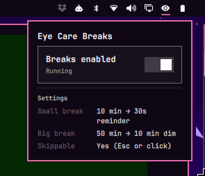
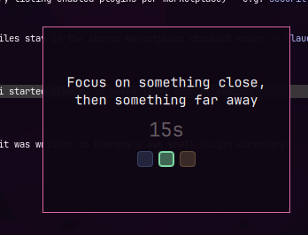
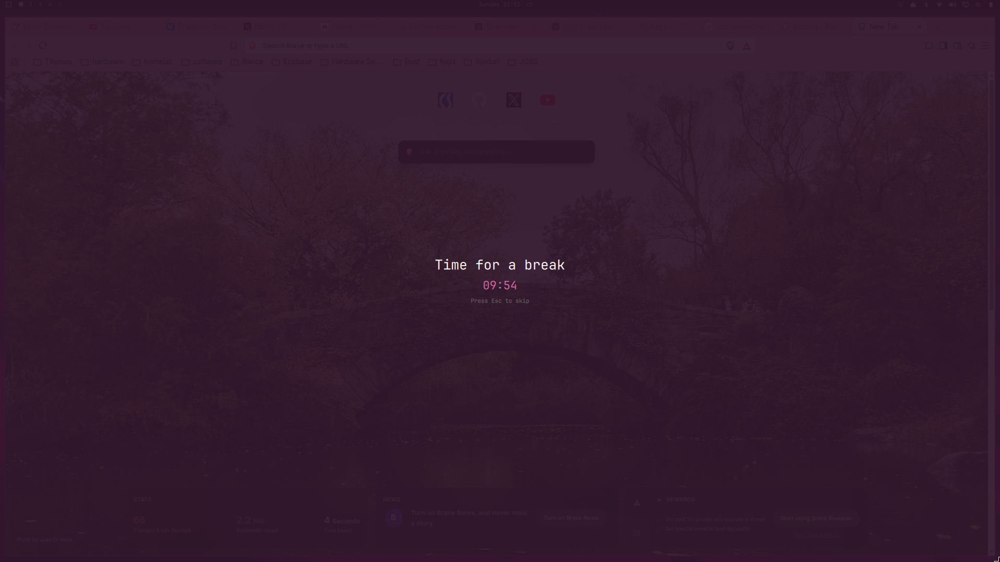

# omarchy-eye-care

An eye strain break reminder, built as a
plugin for the [Omarchy](https://omarchy.org) Quatro shell (Quickshell on
Hyprland). Inspired by an old time favorite of mine [EyeLeo](https://eyeleo.com/)

It runs two independent break cycles, both timed from shell start (or from
the end of the last big break, which resets both):

- **Small break** — every `smallIntervalMinutes`, a small reminder window
  pops up in the center of every screen for `smallBreakSeconds`, showing a
  short eye-exercise message.
- **Big break** — every `bigIntervalMinutes`, every screen dims to a
  theme-tinted overlay with a "Time for a break" message for
  `bigBreakMinutes`. Optionally skippable with `Esc` or a click, per
  `bigBreakSkippable`.

The plugin also adds a bar widget with a status glyph (idle / running /
break in progress) and a popup to pause/resume the cycle and view the
current settings.

## Screenshots

| Bar widget | Small break | Big break |
| --- | --- | --- |
|  |  |  |

## Layout

```
cvatca.eyecare/
├── manifest.json   # plugin id, entry points, bar widget registration
├── Service.qml      # timers, break windows (small + big), IPC handler
└── BarWidget.qml    # bar icon + settings/pause popup
```

This is a working copy for editing/version control. The live plugin that
Omarchy's shell actually loads runs from
`~/.config/omarchy/plugins/cvatca.eyecare/`.

## Installing / updating

Omarchy loads shell plugins from `~/.config/omarchy/plugins/<plugin-id>/`.
To deploy changes made here:

```bash
cp cvatca.eyecare/*.qml cvatca.eyecare/manifest.json \
   ~/.config/omarchy/plugins/cvatca.eyecare/
```

Then reload the Omarchy shell (or restart the session) to pick up changes.

## Uninstalling

Remove the plugin's installed copy and its entry from `shell.json`:

```bash
rm -rf ~/.config/omarchy/plugins/cvatca.eyecare
```

Then remove the `cvatca.eyecare` entry from the `plugins` array (and, if
present, from `bar.layout`) in `~/.config/omarchy/shell.json`, and reload
the Omarchy shell (or restart the session).

## Configuration

Settings live in the plugin's entry inside the `plugins` array of
`~/.config/omarchy/shell.json`, matched by manifest `id`:

```json
{
  "plugins": [
    {
      "id": "cvatca.eyecare",
      "smallIntervalMinutes": 10,
      "smallBreakSeconds": 30,
      "bigIntervalMinutes": 50,
      "bigBreakMinutes": 10,
      "bigBreakSkippable": true
    }
  ]
}
```

| Key | Default | Description |
| --- | --- | --- |
| `smallIntervalMinutes` | 10 | Minutes between small breaks |
| `smallBreakSeconds` | 30 | How long a small break window stays up |
| `bigIntervalMinutes` | 50 | Minutes between big breaks |
| `bigBreakMinutes` | 10 | How long the big break dims the screens |
| `bigBreakSkippable` | true | Whether Esc/click can skip the big break |
| `bigMessage` | "Time for a break" | Message shown during the big break |
| `smallMessage` | — | Fixed message for every small break, if set |
| `smallMessages` | (built-in pool) | Custom pool to pick a random small-break message from |

To show the bar widget, add `{ "id": "cvatca.eyecare" }` to a section of
`bar.layout` in `shell.json` (e.g. `right`, alongside the other indicators).

## IPC

The service registers an `eyecare` IPC target with:

- `status` — JSON with pause state, active break, remaining seconds, and
  current config
- `pause` / `resume` / `toggle` — control the break cycle
- `skip` — skip the current big break (if skippable)
- `triggerSmall` / `triggerBig` — manually fire a break, for testing

Example: `qs ipc call eyecare status` (or however the installed Omarchy
IPC client is invoked).
